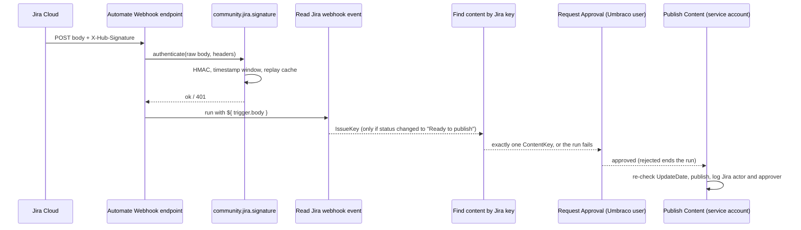

# Design: Jira for Umbraco Automate

| | |
|---|---|
| Package ID | `Umbraco.Community.Automate.Jira` |
| Marketplace title | "Jira for Umbraco Automate" |
| Owner | Pascal Meyer (own GitHub repo, own NuGet account) |
| Targets | Umbraco CMS `[17.8.0,18)` and `[18.3.0,19)`; Umbraco Automate 17.x (floor 17.5.1) and 18.x (floor 18.5.1) |
| Jira | Cloud only |
| Status | Design. Nothing built. Updated for the security review and the F-02 council verdict (see "Security review changes (2026-10-30)"). |
| Written | 2026-10-29, revised 2026-10-30 |
| Sources | [04-automate-jira.md](../04-automate-jira/scope.md) (scope and Decisions), [README.md](../README.md) (portfolio rules), `~/.claude/references/umbraco-pitfalls.md` |

**Tags used in this doc** (same as the README):
- **[verified]**: read or fetched during research on 2026-10-29.
- **[unverified]**: inferred. Check it before relying on it.
- **(architect's call)**: a minor point decided here so the builder doesn't have to guess. Change it if a spike proves it wrong.

Everything reflects 2026-10-29. Automate moves fast. Re-check the [verified] facts at M0.

---

## 1. Intent and why

- **What:** an Umbraco Automate connector for Jira Cloud.
  - Outbound: create issues, add comments, move issues through a workflow.
  - Inbound: receive signed Jira webhooks and turn them into usable fields.
- **Why:**
  - Agencies run delivery in Jira. Editors and site events live in Umbraco. Today nothing joins them without Zapier.
  - **No Jira or Atlassian Automate package exists** on NuGet or the Marketplace [verified, 2026-10-29].
  - The only route today is HQ's Zapier integration. It needs a paid Zapier account and only covers "content published" [verified].
  - Sibling task-tracker connectors exist (`Umbraco.Community.Automate.ClickUp`, `UmbHost.Automate.Teamwork`, `UmbHost.Automate.GitHub`). So the demand is real and nobody has done Jira.
- **For Pascal:** community visibility, and a tool the agency will use on its own client sites.

## 2. Goals, non-goals and anti-goals

**Goals (1.0)**
- A Jira Cloud connection that validates in one click.
- Three outbound actions: Create issue, Add comment, Transition issue.
- Signed inbound webhooks via the built-in Webhook trigger, plus a parser action.
- A "Find content by Jira key" action, so Jira-driven recipes never match pages by name (F-01).
- Package-owned credentials: the API token and webhook secret live in config under `Umbraco:Automate:Jira:Credentials:{name}:*`, which no other Automate step can resolve (F-02 council verdict).
- Retries never create a duplicate issue or comment (F-05).
- Works on Automate 17.x and 18.x, released as major-aligned versions.
- Errors that tell an editor what to fix (bad type name, unavailable transition, expired token).

**Non-goals (1.0)**
- Jira Data Center or Server (Decision 4).
- OAuth 2.0 (3LO). Phase 2.
- Dynamic createmeta pickers (project → type → fields). Phase 2 (Decision 3).
- A dedicated "Jira issue updated" trigger. Not possible yet (see 6.5).
- Get issue, JQL search, attachments, issue links, assign-by-email. Candidates for 1.1.
- Filtering events inside Umbraco. Jira's own webhook JQL does it.
- Named outcome exits (Automate PRs #445/#449). 1.1, once they ship.

**Anti-goals: it fails if any of these happen, even if it works**
- The API token or webhook secret appears in a log, a run record, an error message, an export, a Deploy payload or the database.
- **The package** sends a credential to a host other than Atlassian's (SSRF via a bound or crafted site URL). Restated honestly (F-02): the package cannot stop other code on the site from reading configuration. What it promises is that its own credentials sit outside every prefix Automate resolves, so no Automate step can read them.
- An Automate step other than this package's can resolve the Jira API token or webhook secret.
- An unsigned, wrongly signed or replayed request starts a run.
- A Jira user can publish Umbraco content without an Umbraco user approving it (F-01).
- A node is published because its **name** matches a Jira key.
- Markdown from a public form produces active content in Jira (`javascript:` links, `media` or `extension` nodes).
- Fixing a bug means two pull requests on two branches as routine. (Breaks the README "one build" rule.)
- Open-ended dependency ranges, so the Marketplace badge claims v19 support it doesn't have.
- Renaming an alias after 1.0. Aliases are stored in users' automations. Never rename them (README rule).
- Static caches of scoped services (pitfall P2, Critical).

## 3. Users and the core use cases

**Users**
- **Agency developer:** installs the package, sets up the connection and secrets, writes automations.
- **Site editor or admin:** builds or tweaks automations in the backoffice. Not technical about Jira's APIs.
- **Jira admin (client or agency):** creates the service account, token and webhook.

**Core use cases** (dogfood order per Decision 6 marked ★)

| # | Use case | Flow |
|---|---|---|
| 1 ★ first | Form submission creates a support ticket | Forms "form submitted" trigger (with Forms anti-spam on: honeypot or CAPTCHA, F-19) → **Create issue** (summary and description bound from form fields, Plain text) |
| 2 | Content flagged for review creates a task | **Content Saved** or **Request Approval** rejected [both verified] → **Create issue** with backoffice URL and editor name |
| 3 | Publishing comments on and closes the linked ticket | **Content Published** [verified] → **Get Content Property** (`jiraKey`) → **Add comment** → **Transition issue** to "Done" |
| 4 ★ second | Jira status **requests** publication; an Umbraco user approves | Jira admin webhook (JQL `project = X AND status = "Ready to publish"`) → built-in **Webhook** trigger with `community.jira.signature` → **Read Jira webhook event** → status-change condition → **Find content by Jira key** (package action, exactly one match) → **Log Message** (Jira actor) → **Request Approval** → on approved: re-check → **Publish Content** → **Log Message**. Full recipe and guards in section 6.8. Ships **off by default** with a prominent warning. |
| 5 | Locked user raises a security ticket | **User Locked** [verified] → **Create issue** with label `security` |

- The Forms trigger alias in use case 1 is [unverified]. Confirm at M0.
- **Where `jiraKey` comes from (use cases 3 and 4):** the site models it. The package ships no document type and doesn't write `IssueKey` back onto content (scope: use case 3 reads it with **Get Content Property**). The README gives a recipe (a plain, **invariant** Textstring property called `jiraKey`), and the demo site's document type includes one. Use case 4 reads it with the package's **Find content by Jira key** action (6.7), never with the built-in Find Content, which matches node **names** only [HIGH - source code, `FindContentAction.cs` at `5318996`]. (architect's call for the recipe and demo)

## 4. Constraints

**Automate versions**
- Automate ships parallel lines: 17.0.0–17.5.1 and 18.x up to 18.5.1 [verified, NuGet].
- Community Automate packages are locked to one major: `[17.0.0,18.0.0)` or `[18.0.0,19.0.0)` [verified].
- Our ranges, closed both ends:
  - 18 line: `Umbraco.Automate.Core [18.5.1, 19.0.0)` and `Umbraco.Cms.Core`, `Umbraco.Cms.Infrastructure` `[18.3.0, 19.0.0)`.
  - 17 line: `Umbraco.Automate.Core [17.5.1, 18.0.0)` and `Umbraco.Cms.Core`, `Umbraco.Cms.Infrastructure` `[17.8.0, 18.0.0)`.
  - Lower a floor only after testing on that older minor. The CMS floors are a portfolio decision (Pascal, 2026-10-30) and are never lowered.
- **Why the CMS floors are explicit.** The CMS floors cover the 27 Oct 2026 security round (start-node bypasses) and the disabled-user token reissue fix (portfolio README). Automate does not enforce them: every Automate.Core 17.x nuspec allows CMS `[17.4.0 or 17.6.0, 17.999.999)`, and every 18.x nuspec allows CMS `>= 18.0.0` or `>= 18.1.0` with no upper bound [HIGH - tool output, NuGet flat-container nuspecs, 2026-10-30]. So the package references the CMS packages directly at the floor. It also needs them for real now: Find content by Jira key (6.7) uses Examine and `IContentService`.
- **Automate floors.** Every published Automate.Core release on each line accepts our CMS floor, so the CMS floor does not push the Automate floor up [HIGH - tool output, same nuspecs]. The Automate floors stay at the latest patch on each line (17.5.1, 18.5.1) because those are the only builds the security review and S1 check, and because of `CredentialHeaderNames` and `IsSensitive` (below). Releases on NuGet at 2026-10-30: Automate.Core 17.0.0 to 17.5.1 and 18.0.0 to 18.5.1; CMS latest 17.8.0 and 18.3.0 [HIGH - tool output].
- `IsSensitive` and `CredentialHeaderNames` exist on `v17/dev` [verified]. Whether they're in every 17.x NuGet release is [unverified]. That's one reason the 17 floor is 17.5.1. With package-owned credentials (F-02), `IsSensitive` no longer guards the Jira secrets themselves, but `CredentialHeaderNames` still keeps `X-Hub-Signature` out of run records (F-03 item 4).

**Jira Cloud only** (Decision 4)
- REST API v3 and ADF.
- Site URL must be `https://<name>.atlassian.net`.
- Data Center differs: REST v2, PAT Bearer auth, wiki markup, and probably no `X-Hub-Signature` [unverified]. Data Center EOL is 28 March 2029 (sources differ by two days) [unverified on Atlassian's own page].
- Keep `IJiraClient` an interface so a Data Center client could be added later. Don't build for it.

**Secrets** (revised for F-02; full design in 7.6)
- Issues are created by a **dedicated Atlassian service account with a scoped API token** (Decision 1). Not a personal token.
- **Storage changed (F-02 council verdict, accepted by Pascal 2026-10-30):** the email, API token and webhook HMAC secret live in config under `Umbraco:Automate:Jira:Credentials:{name}:*`. That prefix is **not** in Automate's `AllowedConfigurationKeyPrefixes`, so Automate's `$` reference resolver refuses it for every step type [HIGH - source code, `ConfigurationReferenceResolver.cs` and `AutomateOptions.cs` at `5318996`]. The connection and the authenticator store only a non-sensitive credential **name**. No `$Umbraco:Automate:Secrets` mode ships in 1.0.
- Why: Automate resolves `$Umbraco:Automate:Secrets:*` into any sensitive field of any step, so any Automate author could send the token anywhere with the built-in HTTP Request action (F-02).
- This depends on the **isolation spike S7** (section 8), which is M0 gate 1. If it fails, the fallback is the council's option 2 (section 7.6, "Fallback").
- API tokens expire after at most 365 days [verified, secondary sources]. Our requirement: 90 days or less (F-10).

**Rate limits** [verified, Atlassian docs]
- Per-issue writes: 20 per 2 seconds and 100 per 30 seconds, plus burst limits.
- 429 responses carry `Retry-After`.
- API-token traffic is **not** in the 3LO points quota (Tier 1, 65,000 points/hour, enforced since 2 March 2026). That only matters in phase 2.

## 5. Decisions already made (Pascal, 2026-10-29)

All six recommended defaults were accepted.

| # | Decision |
|---|---|
| D1 | Issues are created by a dedicated Atlassian **service account** with a **scoped API token**. ~~Stored in `Umbraco:Automate:Secrets`.~~ Storage superseded on 2026-10-30 by the F-02 council verdict: package-owned credentials under `Umbraco:Automate:Jira:Credentials:{name}:*` (section 4, 7.6). |
| D2 | Inbound events in 1.0 use the **built-in Webhook trigger + `community.jira.signature` authenticator + "Read Jira webhook event" action**. Raise an HQ issue asking the endpoint to route custom `IWebhookTrigger`s. |
| D3 | **Fixed fields plus `AdditionalFieldsJson`** escape hatch, with a light createmeta lookup for type names (option C). Dynamic createmeta pickers in phase 2. |
| D4 | **Jira Cloud only.** No Data Center. |
| D5 | **Major-aligned versioning:** 17.x and 18.x. |
| D6 | **Dogfood** on a sandbox Jira project on the agency site. Start with "form submission creates a ticket", then "Jira status publishes content". |

Portfolio rules that also apply (README):
- Pascal owns it. Neutral `Umbraco.Community.*` ID so it can move to an organisation later.
- Never rename IDs or aliases.
- One build where possible.

### Reconciling D5 with "one build where possible"

These don't conflict. D5 fixes the **version numbers**. The README rule is about **how many codebases** there are.

- **One codebase, one `main` branch, two packages per release** (architect's call).
- A single MSBuild property switches the line: `AutomateMajor` = `17` or `18`.
  - In `Directory.Build.props`:
    - sets the `Umbraco.Automate.*` package versions and the closed range for that major;
    - sets `VersionPrefix` to `17.x.y` or `18.x.y` from one shared minor/patch (for example `$(AutomateMajor).$(PackageMinor).$(PackagePatch)`);
    - defines a compile constant `AUTOMATE_17` or `AUTOMATE_18`.
- CI runs a matrix: `dotnet test` and `dotnet pack -p:AutomateMajor=17` and `=18`.
- One tag per release, `release/<minor>.<patch>[-pre]`, produces `17.<minor>.<patch>` and `18.<minor>.<patch>` together (architect's call; the builder may pick a different tag shape as long as one tag ships both).
- Where Automate's APIs differ between 17 and 18, use `#if AUTOMATE_18` in the smallest possible spot, or a tiny per-line shim file included by `Condition="'$(AutomateMajor)'=='17'"`.
- **Fallback:** if M0 finds the APIs differ so much that `#if` spreads across many files, switch to the scope doc's plan (`main` = 18, `v17` branch, cherry-picks). Record why in the repo README.
- **Go/no-go:** spike S0 is time-boxed to 1 day. "Fails" means more than ~3 files need `#if`, or the two lines need different TFMs that the test harness can't cover in one project. The builder takes the fallback without waiting for Pascal. (architect's call)
- The target framework is whatever each Automate major requires. If both use the same TFM (likely `net10.0`, [unverified] for 18), the switch is purely the dependency set.
- This replaces the scoping doc's "`main` and `v17` branches" plan. Decision 5 doesn't depend on branches, so this honours both.

## 6. Functional spec (MVP)

**Conventions**
- Action aliases use the `community.jira.` prefix. The connection alias is `community.jira.cloud`, and the authenticator alias is `community.jira.signature` (portfolio decision, 2026-10-30). **These are permanent.**
- **Freeze point:** aliases and setting/output field names are frozen at the first public beta (`-beta.1`), not before. M0 spikes may still change them. The `0.0.1-alpha` placeholder contains no aliases. (architect's call)
- Action aliases in 1.0: `community.jira.createIssue`, `community.jira.addComment`, `community.jira.transitionIssue`, `community.jira.readWebhookEvent`, `community.jira.findContentByKey`.
- Every action that calls Jira is tied to the connection with `ConnectionTypeAlias = "community.jira.cloud"`. The two actions with no HTTP calls (`readWebhookEvent`, `findContentByKey`) follow the S1 answer (6.6).
- **Identifier validation (F-09).** Every bound identifier is trimmed and checked before any URL is built, failing with `Validation` and no HTTP call:
  - issue key or ID: `^[A-Z][A-Z0-9_]*-[1-9][0-9]*$` (case-insensitive) or `^[1-9][0-9]*$`;
  - project key or ID: `^[A-Z][A-Z0-9_]{1,254}$` (case-insensitive) or numeric;
  - transition ID: numeric (anything else is treated as a name, 6.4).
  `Uri.EscapeDataString` stays as defence in depth. This lives in one place, `JiraIdentifiers` (7.1).
- Errors return `ActionResult.Failed(ex, StepRunErrorCategory.X)` [verified pattern]. Categories are in section 7.4.
- "Supports bindings" means `[Field(SupportsBindings = true)]`, so `${ … }` expressions work.

### 6.1 Connection: `community.jira.cloud` ("Jira Cloud (API token)")

Base class: `ConnectionTypeBase<JiraConnectionSettings>` with `[ConnectionType("community.jira.cloud", …)]`.

| Field | Type | Required | Bindings | Notes |
|---|---|---|---|---|
| `SiteUrl` | string | yes | **no** | Validated by `JiraSiteUrl` (below, F-12). Trailing slash stripped. |
| `CredentialName` | string | yes | no | **Not sensitive.** The name of a package-owned credential: the package reads `Umbraco:Automate:Jira:Credentials:{CredentialName}:Email` and `:ApiToken` itself (7.6). Trimmed, ASCII only, lower-cased, then must match `^[a-z0-9]{1,32}\z` (`credential-helper-contract.md` §1.2). |
| `CloudId` | string? | see note | no | GUID. When set, calls go through `https://api.atlassian.com/ex/jira/{cloudId}`. Scoped tokens need this route [HIGH - official docs, cited in security review F-10]. |

- **Email moved into the credential (architect's call).** The service account email sits next to its token in config (`…:{name}:Email`), so an author cannot pair a credential's token with a different account, and the connection holds nothing per-environment except the site.
- `SiteUrl` validation (F-12): trim, then the regex `^https://[a-z0-9-]+\.atlassian\.net/?\z` (case-insensitive, `\z` not `$`), then `Uri.TryCreate` and assert: scheme `https`; empty `UserInfo`; `IsDefaultPort`; `AbsolutePath` is `/`; no query or fragment; `Host` ends with `.atlassian.net` with exactly one label before it.

- **CloudId and scoped tokens:** D1 uses scoped tokens, so in practice `CloudId` is needed. Spike S3 confirms. If confirmed:
  - `ValidateAsync` looks it up when blank from `GET {SiteUrl}/_edge/tenant_info` (unauthenticated, returns `cloudId`) [unverified endpoint] and tells the user to paste it in. Don't save it silently. (architect's call) That request carries **no** `Authorization` header (F-12).
  - `CloudId` must parse as a GUID. Otherwise reject before any request (path-injection guard).
- **Auth header:** `Basic base64(email:token)` on both routes, built from the resolved credential.
- **Base URL:** `SiteUrl` if `CloudId` is blank, else the gateway. `IssueUrl` always uses `SiteUrl/browse/{key}`.
- **Validate:** resolve the credential (7.6), then `GET /rest/api/3/myself`. The message has these parts (exact wording is the builder's):
  - "Connected to {site} as {displayName} via {site route | Atlassian gateway}" (F-10: a classic token on the site route is visible).
  - "Credential '{name}' is site-wide: any workspace's connection can name it." (council condition 5)
  - "Anyone with Automate access to this workspace can use this connection to act in Jira as {displayName}." (council condition 5)
  - Warnings, each only when it applies:
    - **site route** → "This is a classic (unscoped) token. Use a scoped token through the gateway." (F-10)
    - **excess permissions** → `GET /rest/api/3/mypermissions?permissions=ADMINISTER,ADMINISTER_PROJECTS,SYSTEM_ADMIN` reports any held → "The service account is a Jira admin. Remove admin rights." Only if S3 shows this call needs **no** scope beyond the minimum list; a warning never widens the token (architect's call). Otherwise the route warning is the only excess-scope signal.
    - **credential in a file** → the credential's value comes from an `appsettings*.json` file provider (not user-secrets, env vars or Key Vault) → "Credential '{name}' is read from {file name}. Move it to environment variables, Umbraco Cloud secrets or Key Vault." (council condition 7, the committed-credential check)
  - The message never contains the email, the token or any part of either.

Acceptance criteria
- **Given** a valid site and a configured credential name, **when** I click Validate, **then** I see "Connected to {site} as {displayName} via {route}" **and** the site-wide and workspace-access statements.
- **Given** a wrong token, **when** I validate, **then** I see "Jira rejected the credentials (401)", **and** the token appears in neither the message nor the logs.
- **Given** a credential name with no `Email` or `ApiToken` in config, **when** I validate, **then** I get an error naming the missing config **key** (never a value) **and** no HTTP request is sent (council test 7).
- **Given** a credential name containing `..`, `:`, `_`, `-` or nothing, **when** I validate or a step uses the connection, **then** I get a validation error that does not echo the name **and** no config lookup happens (council test 3).
- **Given** `AllowedConfigurationKeyPrefixes` contains `Umbraco:Automate:Jira:Credentials` or any parent of it (`Umbraco`, `Umbraco:Automate`, `Umbraco:Automate:Jira`), **when** I validate or any step runs, **then** credential lookup refuses with an error that names the offending prefix (fail closed, council condition 2).
- **Given** a site URL that isn't `https://*.atlassian.net` (including one with a trailing newline, a query or a fragment), **when** I validate or a step uses the connection, **then** I get a validation error **and** no HTTP request is sent.
- **Given** a `CloudId` that isn't a GUID, **when** I validate or a step uses the connection, **then** I get a validation error **and** no request is sent.
- **Given** a saved connection, **when** I export, Deploy or inspect the database, **then** only the credential **name** is there (council test 4).
- **Given** the credential is read from `appsettings.json`, **when** I validate, **then** the message warns me to move it.

### 6.2 Action: `community.jira.createIssue` ("Create Jira issue")

Input (all support bindings except `DescriptionFormat` and `AdditionalFieldsJson`)

| Field | Type | Required | Notes |
|---|---|---|---|
| `ProjectKey` | string | yes | e.g. `SUP`. Validated (F-09). |
| `IssueType` | string | yes | Name or numeric ID. A name is resolved via `GET /rest/api/3/issue/createmeta/{project}/issuetypes`, case-insensitive, cached. |
| `Summary` | string | yes | Newlines replaced with spaces, trimmed, cut to 255 chars. |
| `Description` | string | no | Markdown editor UI: `EditorUiAlias = "Umb.PropertyEditorUi.MarkdownEditor"` (ClickUp precedent [verified]). |
| `DescriptionFormat` | enum | no | `PlainText` (default), `Markdown`, `AdfJson`. |
| `Labels` | string | no | Comma-separated. Trimmed, spaces → `-`, empties dropped, duplicates removed. |
| `Priority` | string | no | Priority **name**, sent as `{ "name": … }`. |
| `AssigneeAccountId` | string | no | Sent as `{ "accountId": … }`. |
| `ParentKey` | string | no | Sent as `{ "key": … }`. For sub-tasks and epic children. Validated as an issue key (F-09). |
| `AdditionalFieldsJson` | string | no | A JSON object merged into `fields`. **No bindings** (F-04). |
| `DedupeKey` | string | no | Widens duplicate protection across runs (below). Bindings yes. |

`AdditionalFieldsJson` rules (F-04, replaces the earlier "keys win" rule):
- `SupportsBindings = false`. A bound value spliced into JSON is an injection point [HIGH - source code, `BindingEvaluator` splices verbatim, per security review].
- Must parse as a JSON object (`JsonDocumentOptions.MaxDepth = 32`), or fail with `Validation` before any HTTP call.
- **Duplicate keys** at any depth fail with `Validation` (plan review P6).
- **Allowed keys only**, matched ordinally and case-sensitively after JSON unescaping: `customfield_` followed by digits (`^customfield_[0-9]+\z`), `components`, `fixVersions`, `versions`, `duedate`, `environment`, `labels`. Any other key fails with `Validation` before HTTP. That includes the **protected keys** `project`, `issuetype`, `summary`, `description`, `reporter`, `security` and `parent`, which come only from typed fields.
- A key that is also set by a typed field (only `labels` today) fails with `Validation`: "set labels in one place". Nothing silently wins.
- Every value in the final `fields` object shaped like `{ "type": "doc", … }`, at any depth (inside arrays and nested objects too), goes through `AdfSanitiser` (7.5), not just `description`.

**Duplicate protection (F-05, in 1.0 unconditionally)**
- Automate retries every step by default (`ErrorBehavior = Retry`, up to 10), and no action can opt out [HIGH - source code at `5318996`, security review F-05]. Actions can't see their attempt number: `ActionContext` has `RunId` and `StepId` but no attempt counter [HIGH - source code, `ActionContext.cs` at `5318996`].
- **Effective key (revised 2026-10-30, plan review P3):** `DedupeKey` (trimmed) when set; otherwise `"{AutomationId}:{RunId}:{StepId}:{IterationId or -}:{InputFingerprint}"`. `IterationId` is the ForEach item identity if spike Task 3 finds one on `ActionContext`. `InputFingerprint` is 16 lower-case hex of SHA-256 over the resolved identity inputs (Create issue: `ProjectKey`, `IssueType`, `Summary`, `Description`; Add comment: `IssueKey`, `Body`), each length-prefixed. Retries of one step in one iteration resolve the same inputs, so they are idempotent with no configuration. ForEach items with different data never share a key, so no item silently gets another item's ticket. Residual: identical items with no iteration identity collapse to one ticket; the README says to set a per-item `DedupeKey` inside ForEach. A user key widens protection across runs.
- **Marker (revised 2026-10-30, plan review P18):** the first 16 lower-case hex characters of HMAC-SHA256, keyed with the connection ID's 16 bytes, over the UTF-8 effective key. The raw key never leaves Umbraco. The connection ID survives token rotation and is not visible to Jira users, so a Jira user who sees the marker cannot confirm a guessed key (an unsalted hash could be reversed by dictionary). It is not encryption: anyone with backoffice access can recompute it, so the README still recommends non-personal keys. Recreating the connection restarts cross-run dedupe. (architect's call)
- **A failed dedupe search** (401, 403, 429, 5xx, network) fails the step with the mapped category and never POSTs. Automate's retry repeats the search.
- **Tag in the same write.** The create request itself carries the marker, so there is no window between creating and tagging. The marker is an issue property `community.jira.dedupe` = `{ "key": "<hash>" }` if S3/Task 4 shows issue properties are JQL-searchable; otherwise a label `cj-dedupe-<hash>`. (Plain REST properties are often not JQL-indexed [DATED]; the label is the expected outcome.)
- **Read first, every attempt.** Before the POST, `POST /rest/api/3/search/jql` with `project = "<key>" AND <marker predicate>`, `maxResults: 1`. A hit returns that issue with `WasExisting = true` and no POST. Searching on every attempt costs one call per create. A cache "attempted" marker to skip the first search was rejected: it is lost on restart and on other nodes, which is exactly when retries matter. (architect's call)
- Residual: Jira search is eventually consistent [DATED]. A retry that lands before Jira indexes the first create can still duplicate. Task 4 measures the lag against Automate's retry interval.

Output

| Field | Type | Example |
|---|---|---|
| `IssueId` | string | `10042` |
| `IssueKey` | string | `SUP-17` |
| `IssueUrl` | string | `https://acme.atlassian.net/browse/SUP-17` |
| `WasExisting` | bool | `false` (true when the dedupe search found the issue) |

Calls: `POST /rest/api/3/search/jql` (dedupe check), then `POST /rest/api/3/issue` (one write). Plus a cached createmeta GET when `IssueType` is a name.

Acceptance criteria
- **Given** a valid project and type, **when** the step runs, **then** an issue exists **and** `IssueKey` and `IssueUrl` can be bound by later steps.
- **Given** Markdown with a heading, a list and a link, **when** the step runs, **then** Jira shows a heading, a list and a link.
- **Given** Plain text with a blank line and a single newline, **when** the step runs, **then** Jira shows two paragraphs and a line break.
- **Given** an unknown issue type name, **when** the step runs, **then** it fails with `Validation` **and** the message lists the valid types for that project.
- **Given** Jira returns 400 with `errors`, **when** the step fails, **then** the run log shows Jira's field errors.
- **Given** Jira returns 429 with `Retry-After`, **when** the step fails, **then** the category is `RateLimiting` **and** the log records the delay.
- **Given** `AdditionalFieldsJson` isn't a valid JSON object, **when** the step runs, **then** it fails with `Validation` **before** any HTTP call.
- **Given** `AdditionalFieldsJson` contains `project`, `description` or any key outside the allowed list, **when** the step runs, **then** it fails with `Validation` **before** any HTTP call.
- **Given** a textarea custom field in `AdditionalFieldsJson` holds an ADF doc with an `inlineCard`, **when** the step runs, **then** the card is unwrapped to text.
- **Given** the POST times out after Jira saved the issue, **when** Automate retries the step, **then** the search finds the issue **and** no second issue is created.
- **Given** a `DedupeKey` of `form-123` and an issue already carrying its marker, **when** a new run executes, **then** that issue is returned with `WasExisting = true` **and** no request body contains `form-123`.
- **Given** the same project and type name twice within the cache window, **when** both steps run, **then** createmeta is called once.

### 6.3 Action: `community.jira.addComment` ("Add Jira comment")

Input (all support bindings except `BodyFormat`)

| Field | Type | Required | Notes |
|---|---|---|---|
| `IssueKey` | string | yes | Key or ID. Validated (F-09). |
| `Body` | string | yes | Markdown editor UI |
| `BodyFormat` | enum | no | Same as `DescriptionFormat`, default `PlainText` |
| `DedupeKey` | string | no | Same meaning as in 6.2. |

Output: `CommentId`, `CommentUrl` (`{SiteUrl}/browse/{key}?focusedCommentId={id}`), `WasExisting` (bool).

Calls: `GET /rest/api/3/issue/{key}/comment?orderBy=-created&maxResults=50&expand=properties` (dedupe check), then `POST /rest/api/3/issue/{key}/comment`.

**Duplicate protection (F-05 item 4).** Same effective key and hash as 6.2.
- **Preferred:** the POST body carries `properties: [{ "key": "community.jira.dedupe", "value": { "key": "<hash>" } }]` [DATED: comment-create `properties` and `expand=properties` on the list; Task 4 probes both]. Every attempt first lists the 50 newest comments and returns a match with `WasExisting = true`.
- **Fallback, if the probe fails:** no read-first. A failure after the request was sent (timeout, network error after send, 5xx) maps to `Validation`, the only terminal category whose meaning fits "do not retry this automatically" [HIGH - source code, `DefaultStepErrorClassifier` terminal set]. Message: "Jira may already have saved this comment on {key}. Check the issue before re-running."
- `transitionIssue` needs neither: the already-in-status check makes it idempotent.

Acceptance criteria
- **Given** an existing issue, **when** the step runs, **then** the comment appears **and** `CommentId` is returned.
- **Given** a missing issue, **when** the step runs, **then** it fails with `Validation` and "Issue X not found or no permission" (Jira returns 404 for both).
- **Given** an empty body after trimming, **when** the step runs, **then** it fails with `Validation` before any HTTP call.
- **Given** an `IssueKey` of `..`, `.` or `SUP-1/..`, **when** the step runs, **then** it fails with `Validation` **and** no request is sent.
- **Given** the POST timed out after Jira saved the comment, **when** Automate retries, **then** no second comment is posted.

### 6.4 Action: `community.jira.transitionIssue` ("Transition Jira issue")

Input (all support bindings)

| Field | Type | Required | Notes |
|---|---|---|---|
| `IssueKey` | string | yes | Validated (F-09). |
| `Transition` | string | yes | Name or ID. Matched against `GET /rest/api/3/issue/{key}/transitions`, case-insensitive. A non-numeric value is only ever a name, never a path segment. |
| `Comment` | string | no | Plain text, sent as an ADF comment in the same transition call (`update.comment`). |
| `ResolutionName` | string | no | Sent as `fields.resolution.name`. |

Matching order (architect's call): exact ID → transition **name** → **target status name** (`to.name`). Editors usually think "move to Done", which is a status, while the transition may be called "Close". First match wins. Two transitions matching at the same level → fail with `Validation` and list them.

Output: `FromStatus`, `ToStatus`, `TransitionId`.

Calls: `GET /issue/{key}?fields=status`, `GET /issue/{key}/transitions`, `POST /issue/{key}/transitions`.

Acceptance criteria
- **Given** "Done" is available, **when** the step runs, **then** the issue moves **and** `ToStatus` is "Done".
- **Given** the transition isn't available from the current status, **when** the step runs, **then** it fails with `Validation` **and** lists the available transitions.
- **Given** the issue is already in the target status, **when** the step runs, **then** it succeeds as a no-op, logs "already in status", **and** returns `FromStatus` = `ToStatus` with an empty `TransitionId`.
- **Given** a `Comment`, **when** the transition succeeds, **then** the comment is on the issue.
- Phase 2: "not available" and "already in status" become named outcomes once PRs #445/#449 ship.

### 6.5 Webhook authenticator: `community.jira.signature` ("Jira webhook secret")

- Derives from `WebhookAuthenticatorBase<JiraSignatureSettings>` [verified base].
- Plugs into the **built-in** Webhook trigger's authentication picker.
- Must be registered explicitly: `builder.AutomateWebhookAuthenticators().Add<JiraSignatureWebhookAuthenticator>()`. Authenticators are **not** auto-discovered [verified].
- Why custom: the built-in HMAC authenticator reads `X-Webhook-Signature`. Jira sends `X-Hub-Signature` [verified].

Settings

| Field | Type | Notes |
|---|---|---|
| `CredentialName` | string | **Not sensitive, no bindings.** The package reads `Umbraco:Automate:Jira:Credentials:{CredentialName}:WebhookSecret` itself (7.6). Same name pattern as the connection. May be the same name as the connection's credential or a separate one. |

- **Why not `Secret` (F-15).** If the package is removed or fails to register, the core endpoint falls back to the built-in plain-secret authenticator and reads the stored settings against its own schema, whose field is `Secret` [HIGH - source code, security review F-15]. Our field is `CredentialName` and holds no secret, so that fallback resolves an empty secret and fails closed, and even a successful read would only reveal a name. This field name is permanent at `-beta.1`.
- **Constructor dependencies:** `JiraCredentialStore`, `IMemoryCache`, `TimeProvider`, `IOptions<JiraOptions>`, `ILogger`. Whether the authenticator collection builder injects these is [LOW] (security review F-03 item 5). Spike in Task 3. If it does not, resolve them from `context.Request.HttpContext.RequestServices` inside `Validate` (still no statics, P2).

Logic
1. Reject unless exactly **one** `X-Hub-Signature` value is present (F-15). Expect the exact ordinal prefix `sha256=` followed by exactly 64 hex characters (either case) and nothing else; no trimming. Missing, empty, repeated, another method (`sha1=`, `sha512=`), a different-case prefix, surrounding white space or another length → reject.
2. Resolve the webhook secret through `JiraCredentialStore` (7.6). Missing, refused (prefix guard) or shorter than **32 characters** → reject, and log a warning naming the config key, never the value (F-15).
3. Compute HMAC-SHA256 of the request body bytes with the UTF-8 secret. Use `Encoding.UTF8.GetBytes(ctx.Body)` unless the S2 encoding check shows a mismatch for BOM or invalid sequences; then read the buffered raw bytes.
4. Compare with `CryptographicOperations.FixedTimeEquals` on bytes (`Convert.FromHexString` inside a try; bad hex → reject). No other comparison is allowed in the signature code (an IL test and a banned-API analyser enforce it, plan review P5).
5. **Replay window (F-03, in 1.0).** Parse the signed body's `timestamp` (epoch milliseconds, [LOW] on the unit; Task 4 confirms) with `MaxDepth = 32`. Only an integer JSON number in `[0, 253402300799999]` is accepted; any other type or range rejects without throwing. Missing, unparseable or more than `ReplayWindowMinutes` (default 120, covering Jira's roughly 75-minute retry span [HIGH - official docs, per security review]) away from `TimeProvider.GetUtcNow()` → reject.
6. **Replay cache (F-03).** Key `jira:wh:{scope}:{sha256(body) hex}` in `IMemoryCache`, absolute expiry = the window, where `scope` is the `automationId` route value, or SHA-256 of the lower-cased request path if spike Task 3 finds no automation ID (plan review P16). The check and the add are one atomic step (a lock in the singleton guard), so two identical concurrent deliveries cannot both pass (P5). Already present → reject. Otherwise add it, then accept.
6a. Any exception inside `Validate` → reject and log the exception type only (fail closed, P5). The unsigned `X-Atlassian-Webhook-Identifier` header is **never** used for this.
7. List `X-Hub-Signature` in `CredentialHeaderNames`, so it's never stored with a run [verified mechanism]. A run record must never hold a replayable body-plus-signature pair.

Residuals (documented in the README):
- The replay cache is per node. On a load-balanced site a replay to a different node inside the window passes. A distributed cache is the 1.1 upgrade.
- Jira's documented duplicate deliveries and its retries reuse the same body (to verify in Task 4), so they are rejected as replays. That is the intended effect, but it also means a run that failed to start after authentication is not re-delivered by Jira inside the window.
- Jira's body-only signature can't be fixed here. If Atlassian changes the method, deliveries fail closed.

Acceptance criteria
- **Given** Atlassian's test vector (secret `It's a Secret to Everybody`, body `Hello World!`), **when** it's checked, **then** it passes [vector verified, Atlassian docs]. (Test harness only: the vector secret is under 32 characters, so the length rule is bypassed in that one test by calling the HMAC routine directly.)
- **Given** a missing signature, a wrong signature, two signature headers, a non-64-hex value or a method other than `sha256`, **when** a request arrives, **then** the endpoint returns 401 **and** no run starts.
- **Given** a credential name whose secret is under 32 characters or missing, **when** a request arrives, **then** 401 **and** a log warning naming the key only.
- **Given** a valid request delivered twice within the window, even with a different `X-Atlassian-Webhook-Identifier`, **when** the second arrives, **then** 401 **and** no run starts.
- **Given** a body whose `timestamp` is outside the window or missing, **when** it arrives, **then** 401.
- **Given** a valid request, **when** the run is stored, **then** `X-Hub-Signature` is absent from the trigger output.

**Why no native trigger** [verified, `v18/dev` at `5318996`]
- `WebhookEndpointController` resolves `_triggers.GetByAlias<WebhookTrigger>(alias)`. `WebhookTrigger` is **sealed**.
- A custom `WebhookTriggerBase` subclass gets no URL and no routing.
- So D2. An HQ issue is raised in parallel (section 10).

### 6.6 Action: `community.jira.readWebhookEvent` ("Read Jira webhook event")

- Turns the raw webhook body into bindable fields.
- No connection needed (no HTTP calls). Whether an action can omit `ConnectionTypeAlias` is checked at M0 (spike S1).
  - If it can't: set `ConnectionTypeAlias = "community.jira.cloud"` and simply ignore the connection. Users already have one for the outbound actions. Don't invent a dummy connection type, because that would be another permanent alias. (architect's call)
- Signature versus parsing: the authenticator checks the raw request bytes before parsing, inside the core endpoint. The parser only reads the stored `Body` string afterwards. They don't need to be byte-identical. (architect's call)

Input

| Field | Type | Required | Notes |
|---|---|---|---|
| `Body` | string | yes | Default binding `${ trigger.body }`. |

Output

| Field | Type | Source in payload |
|---|---|---|
| `WebhookEvent` | string | `webhookEvent`, e.g. `jira:issue_updated` |
| `IssueKey` | string | `issue.key` |
| `IssueId` | string | `issue.id` |
| `ProjectKey` | string | `issue.fields.project.key` |
| `IssueType` | string | `issue.fields.issuetype.name` |
| `Summary` | string | `issue.fields.summary` |
| `Status` | string | `issue.fields.status.name` |
| `StatusChangedFrom` | string? | `changelog.items[field=status].fromString` |
| `StatusChangedTo` | string? | `changelog.items[field=status].toString` |
| `UserAccountId` | string? | `user.accountId` |
| `UserDisplayName` | string? | `user.displayName` |
| `Changes` | list of `{ Field, From, To }` | `changelog.items[]` (`field`, `fromString`, `toString`) |
| `CommentBody` | string? | `comment.body`, ADF flattened to plain text |
| `Timestamp` | long? | `timestamp` (architect's call: cheap and useful for logs) |

- Missing optional parts → empty or null outputs, not a failure.
- Supported events for 1.0: `jira:issue_created`, `jira:issue_updated`, `comment_created`, `comment_updated`. Other events still parse the common fields if present.
- **Minimal outputs (F-06).** Only the fields above. No full field dump. `Changes` keeps only `field`, `fromString`, `toString`.
- **Parsing limits (F-11).** `JsonDocumentOptions.MaxDepth = 32`; deeper → `Validation`. The body is already capped at 1 MB by the core endpoint.
- **Untrusted text (F-17).** `Summary`, `CommentBody`, `UserDisplayName` and `Changes` are text any Jira user controls. The field descriptions and the README label them "untrusted user text" and recommend `| strip_html` or plain-text targets.

Acceptance criteria
- **Given** a real `jira:issue_updated` payload with a status change, **when** the step runs, **then** `StatusChangedTo` holds the new status name.
- **Given** a `jira:issue_updated` payload with no status change (a comment or label edit), **when** the step runs, **then** `StatusChangedFrom` and `StatusChangedTo` are null (F-07).
- **Given** JSON nested deeper than 32 levels, **when** the step runs, **then** it fails with `Validation`.
- **Given** a `comment_created` payload, **when** the step runs, **then** `CommentBody` is plain text **and** `IssueKey` is set.
- **Given** a body that isn't JSON, or JSON without `webhookEvent`, **when** the step runs, **then** it fails with `Validation`.

### 6.7 Action: `community.jira.findContentByKey` ("Find content by Jira key")

New in 1.0 (F-01 item 5, Pascal 2026-10-30). Finds the one content node whose Jira-key property equals a given key. It exists because the built-in Find Content matches node **names** only, which any editor with update rights can change [HIGH - source code, `FindContentAction.cs` at `5318996`].

Attribute: `[Action("community.jira.findContentByKey", "Find content by Jira key", Group = "Content", RequiredSections = [Constants.Applications.Content], RequiredPermissions = [ActionBrowse.ActionLetter])]`. No HTTP and no Jira connection: `ConnectionTypeAlias` follows the S1 answer exactly as `readWebhookEvent` does (6.6).

- **Not `ICmsAction`.** In Automate, `ICmsAction` is the audit marker for actions that **modify** CMS entities, and the built-in Find Content deliberately does not implement it [HIGH - source code, `ICmsAction.cs`, `FindContentAction.cs`]. This action only reads. The security review's sketch said "implements `ICmsAction`"; that is not applied, for this reason. The publish is audited by Publish Content, which is an `ICmsAction`.

Input

| Field | Type | Required | Bindings | Notes |
|---|---|---|---|---|
| `IssueKey` | string | yes | yes | Trimmed, upper-cased, then must match `^[A-Z][A-Z0-9_]*-[1-9][0-9]*$`. Numeric issue IDs are not accepted: the property stores keys. |
| `PropertyAlias` | string | no | **no** | Default `jiraKey`. Must match `^[A-Za-z][A-Za-z0-9_]{0,63}$` (also stops Lucene query injection). |
| `ContentTypes` | content type picker (CSV of keys, like the built-in) | **yes** | **no** | At least one. A stale key fails the step with `ConfigurationError` (fail closed). The built-in silently drops stale keys and then searches **all** types [HIGH - source code]; we don't. |

Output

| Field | Type | Notes |
|---|---|---|
| `ContentKey` | Guid | Bind this into Request Approval's prompt and Publish Content. |
| `Name` | string | Invariant name, for logs and the approval prompt. |
| `ContentTypeAlias` | string | |
| `IsPublished` | bool | Whether any version is currently published. |
| `UpdateDate` | DateTime (UTC) | Draft's last-saved time. The recipe compares it after approval (6.8). |

Behaviour
1. Validate the inputs. Fail with `Validation` (or `ConfigurationError` for stale content types) before touching the index.
2. **Candidates from Examine.** Query the `InternalIndex` (drafts included: a page waiting to go live is often unpublished) with `+__IndexType:content +{PropertyAlias}:"<escaped lower-case key>" +(__NodeTypeAlias:a …)`, escaping with `QueryParserBase.Escape`, at most **10** candidates. 10 or more → fail with `Validation` ("too many candidates; check the property is unique"). Text fields are tokenised, so the phrase can over-match (for example `SUP-17` inside a longer value); step 3 removes those. [LOW] that a Textstring property is indexed under its alias in `InternalIndex`; Task 17a's first test proves it.
3. **Exact verification.** Load the candidates with one `IContentService.GetByIds` call. Keep a node only if it is not trashed, its type is in `ContentTypes`, and its **draft** value of `PropertyAlias`, trimmed, equals the key (ordinal, ignoring case). If the property varies by culture → `ConfigurationError` ("the Jira key property must be invariant").
4. **Exactly one, counted before permissions.** 0 verified → `Validation` ("No {types} content has {alias} = {key}"). More than 1 → `Validation` listing the node **keys**, and nothing is returned. The count happens **before** filtering by the service account's permissions, so a duplicate the service account can't see still blocks the run (fail closed). The built-in filters first [HIGH - source code].
5. **Authorise.** `AuthorizeContentOrFailAsync(contentKey, RequiredPermissions, ct)` on `IAutomationActionAuthorizer`, as Publish Content does [HIGH - source code]. Not authorised → return that failure (the service account's start node excludes it).
6. Log "Found {key} on node {ContentKey}". Never log property values beyond the key.

Pitfalls: no tree traversal (P3); one index query and one batch load (P4, P9); no statics (P2); `IContentService` is used inside the action's own scope, never stored.

Acceptance criteria
- **Given** one Article whose `jiraKey` is `SUP-17`, **when** the step runs with key ` sup-17 `, **then** it returns that node's key.
- **Given** two nodes with `jiraKey` `SUP-17`, one outside the service account's start node, **when** the step runs, **then** it fails with `Validation` listing two keys **and** returns no `ContentKey`.
- **Given** a node **named** `SUP-17` with an empty `jiraKey`, **when** the step runs, **then** it fails with "not found".
- **Given** a node whose `jiraKey` is `SUP-170` or `SUP-17 old`, **when** the step runs with `SUP-17`, **then** that node is not matched.
- **Given** no content types selected, or only stale ones, **when** the step runs, **then** it fails before querying.
- **Given** a trashed node with the key, **when** the step runs, **then** it is ignored.
- **Given** `IssueKey` `SUP-17" OR x:*`, **when** the step runs, **then** it fails with `Validation` before querying.

### 6.8 Use case 4 recipe: Jira requests publication, an Umbraco user approves (F-01, F-07)

Ships **off by default**. The README puts it under "Advanced: Jira-driven publishing", opening with a warning box; the demo site seeds it as a **disabled** automation (council condition 6). No variant without Request Approval is documented (Pascal, 2026-10-30).

Warning text (meaning fixed, wording the builder's): "Anyone who can move a Jira issue into this status can ask for this content to be published. Anyone in this Automate workspace can approve it. Set both up as described below before you enable it."

Recipe, in order:
1. **Webhook** trigger, authenticator `community.jira.signature` with its `CredentialName`.
2. **Read Jira webhook event** (`${ trigger.body }`).
3. **Condition (F-07):** `WebhookEvent == "jira:issue_updated"` and `StatusChangedTo == "Ready to publish"` and `StatusChangedFrom != StatusChangedTo`. Otherwise the run ends. So comments, label edits and Jira duplicates on an issue already in the status publish nothing.
4. **Find content by Jira key** (6.7): `IssueKey` from step 2, `ContentTypes` = the named types. Fails unless exactly one node matches. Never ForEach.
5. **Log Message (repudiation, F-01 item 6):** Jira `UserAccountId`, `UserDisplayName`, `IssueKey`, `ContentKey`.
6. **Request Approval** (built-in, `umbracoAutomate.requestApproval`): prompt bound with the issue key, node name and Jira actor, and "Open the node and review the current draft before approving"; `TimeoutHours` e.g. 72 (auto-reject).
7. On `rejected`: end (optionally **Add Jira comment** "Publication rejected in Umbraco").
8. On `approved`: **Find content by Jira key** again, then a **Condition**: same `ContentKey` and same `UpdateDate` as step 4. If the draft changed while waiting, end and log "content changed after the approval request". (Builder confirms the built-in Condition can compare two bound dates; if not, compare their string forms.)
9. **Publish Content** with `ContentKey`.
10. **Log Message:** `ApprovedByUserKey`, `ContentKey`, `IssueKey`.

Required setup (README, all mandatory):
- **Dedicated workspace** for this automation. Its **service account** has publish rights only on the intended subtree (start node), never the whole tree (F-01 item 3). Publish Content runs as the service account when there is no backoffice user [HIGH - source code, `PublishContentAction.cs`].
- **Workspace members are only users who may publish that subtree.** Automate lets any member of the automation's workspace approve or reject; it does not check publish rights on the node [HIGH - source code, `SubmitApprovalController.cs` at `5318996`: only `AuthorizeWorkspaceAccessAsync`]. Workspace membership already confers the service account's power (members can build automations that publish), so this matches the existing trust model. See "Decisions for Pascal" for a code-level check.
- **Jira side (F-01 item 4):** the webhook JQL is scoped to one project; the "Ready to publish" transition has a workflow condition limiting it to a named group; the webhook's credential is its own name with a 32+ character random secret.
- The published version is the draft at approval time (F-07). Request Approval plus step 8 is the control.

Trust boundary TB4 (Jira users to Umbraco publish rights) is closed by step 6: a Jira identity can only **request**; an Umbraco workspace member decides.

### 6.9 Phase 2 (brief)

| # | Item | Size | Notes |
|---|---|---|---|
| 1.1 | Get issue, JQL search, attachments, links, assign by email | S each | Same client pattern |
| 1.1 | Distributed replay cache (`IDistributedCache`) for load-balanced sites | S | Replaces the per-node `IMemoryCache` store (6.5) |
| 1.1 | Opt-in `$Umbraco:Automate:Secrets` credential mode | S | Only if adoption demands it, labelled "exposed to F-02" (council condition 10) |
| P2a | Named outcomes | S | `Created`/`Failed`; `Transitioned`/`NotAvailable`/`AlreadyInStatus`. Gated on the Automate minor that ships PRs #445/#449 (both OPEN, last updated 6 Oct 2026 [verified]) |
| P2b | OAuth 2.0 (3LO) connection | M–L | `OpenIddict.Client.WebIntegration` has an `Atlassian` provider (7.0.0 and 7.6.0) [verified]. `JiraOAuthComposer` → `AddAtlassian()`. `JiraOAuthConnectionType : OAuthConnectionTypeBase<…>`, `ProviderName = "Atlassian"`. Config `Umbraco:Automate:Providers:Atlassian:*`. Scopes `read:jira-work write:jira-work read:jira-user offline_access` (+ `manage:jira-webhook`). After consent, `GET https://api.atlassian.com/oauth/token/accessible-resources` → store `cloudId`, site picker if several. Spike: refresh-token rotation is saved [unverified]; `prompt=consent` UX |
| P2c | Dynamic createmeta pickers | L | Needs a Lit editor + a `ManagementApiControllerBase` endpoint (pitfall S1) per connection. Automate has no remote-options field data source [verified] |
| P2d | Native trigger + dynamic webhooks | M | Only if HQ routes custom `IWebhookTrigger`s. Dynamic webhooks: 5 per user per tenant, 30-day expiry, narrower JQL, Bearer-signed [verified] |

## 7. Technical design

### 7.1 Project layout (mirrors HQ Slack and the ClickUp add-on)

```
Umbraco.Community.Automate.Jira/
├── Directory.Build.props          AutomateMajor switch, versions, ranges, constants
├── src/Umbraco.Community.Automate.Jira/      (one RCL project) [Slack pattern verified]
│   ├── Credentials/     JiraCredentialStore (~40 lines), JiraCredential, JiraCredentialSourceCheck
│   ├── Connection/      JiraConnectionType, JiraConnectionSettings, JiraSiteUrl (validation), JiraIdentifiers
│   ├── Actions/         CreateIssue*, AddComment*, TransitionIssue*, ReadWebhookEvent*, FindContentByKey*
│   │                    (each: Action, Settings, Output)
│   ├── Webhooks/        JiraSignatureWebhookAuthenticator, JiraSignatureSettings, WebhookReplayGuard
│   ├── Client/          IJiraClient, JiraClient, JiraRequestException, JiraResponseHandler, DTOs
│   ├── Adf/             IAdfConverter, PlainTextAdfConverter, MarkdownAdfConverter,
│   │                    AdfJsonPassthrough, AdfToText, AdfLimits
│   ├── Configuration/   JiraComposer, JiraOptions
│   └── buildTransitive/ props + appsettings-schema.Umbraco.Community.Automate.Jira.json
├── tests/Umbraco.Community.Automate.Jira.Tests/
│   ├── Fixtures/        recorded webhook payloads (scrubbed), golden ADF files
│   └── Contract/        nightly live tests (env-gated)
├── demo/Umbraco.Community.Automate.Jira.TestSite/   SQLite, not packed
└── .github/workflows/   build-test (matrix 17/18), pack-release, nightly-contract
```

- `UseProjectReferences` toggle as in HQ's Slack, so the demo site can run against local Automate source if needed [verified pattern].
- Actions, triggers and connection types are **auto-discovered** by attribute. Authenticators are **not** [verified].

### 7.2 Composition and configuration

`JiraComposer : IComposer`
- `services.AddHttpClient("Umbraco.Community.Automate.Jira")` with our timeout. A **named** client, not Slack's shared default, so timeouts and handlers are ours. `ConfigurePrimaryHttpMessageHandler` sets `AllowAutoRedirect = false` (F-12); a 3xx maps to `InvalidResponse`.
- `services.AddSingleton<JiraCredentialStore>()` (depends only on singletons: `IConfiguration`, `IOptionsMonitor<AutomateOptions>`; P2-safe) and a `UmbracoApplicationStartedNotification` handler that runs the prefix guard once and logs `Critical` if it trips. No network, no heavy work (P7).
- `services.AddScoped<IJiraClient, JiraClient>()`.
- `services.AddSingleton<IAdfConverterFactory, …>()` and the converters (stateless, so singletons are fine).
- `builder.AutomateWebhookAuthenticators().Add<JiraSignatureWebhookAuthenticator>()`.
- `services.Configure<JiraOptions>(config.GetSection("Umbraco:Automate:Jira"))`.

`JiraOptions` (optional, everything else is on the connection)

| Key | Default | Use |
|---|---|---|
| `TimeoutSeconds` | 30 | `HttpClient` timeout |
| `IssueTypeCacheMinutes` | 10 | createmeta cache lifetime |
| `ReplayWindowMinutes` | 120 | Webhook timestamp window and replay-cache lifetime (F-03). Minimum 10, maximum 1440. |

`JiraOptions` binds `Umbraco:Automate:Jira` but has **no** `Credentials` member, so credential values are never bound into an options object that diagnostics could dump (council test 10). Only `JiraCredentialStore` reads the `Credentials` section.

Generate and ship `appsettings-schema.Umbraco.Community.Automate.Jira.json` the way Slack does [verified pattern].

### 7.3 The client: `IJiraClient`

One place for base URL, auth header, JSON options and error mapping. Eleven typed methods: nine always, two only when a spike allows (signatures aligned with the plan, plan review P20; every method also takes a final `CancellationToken ct`):

| Method | HTTP |
|---|---|
| `Task<JiraUser> GetMyselfAsync(JiraTarget target)` | `GET /rest/api/3/myself` |
| `Task<Guid?> GetTenantCloudIdAsync(Uri siteBase)` | `GET {site}/_edge/tenant_info`, no `Authorization` |
| `Task<IReadOnlyList<JiraIssueType>> GetIssueTypesAsync(JiraTarget target, string projectKey)` | `GET /rest/api/3/issue/createmeta/{project}/issuetypes` |
| `Task<JiraCreatedIssue> CreateIssueAsync(JiraTarget target, JsonObject fields, JsonArray? properties)` | `POST /rest/api/3/issue` |
| `Task<JiraCreatedIssue?> FindByDedupeAsync(JiraTarget target, string projectKey, string marker)` | `POST /rest/api/3/search/jql` (F-05) |
| `Task<JiraCreatedComment> AddCommentAsync(JiraTarget target, string issueKey, JsonObject adfBody, string? dedupeMarker)` | `POST /rest/api/3/issue/{key}/comment` (marker sent as a comment property only when the S4 probe passed) |
| `Task<string> GetIssueStatusAsync(JiraTarget target, string issueKey)` | `GET /rest/api/3/issue/{key}?fields=status` |
| `Task<IReadOnlyList<JiraTransition>> GetTransitionsAsync(JiraTarget target, string issueKey)` | `GET /rest/api/3/issue/{key}/transitions` |
| `Task DoTransitionAsync(JiraTarget target, string issueKey, string transitionId, JsonObject? commentAdf, string? resolutionName)` | `POST /rest/api/3/issue/{key}/transitions` |
| Conditional: `Task<JiraCreatedComment?> FindCommentByDedupeAsync(JiraTarget target, string issueKey, string dedupeMarker)` | `GET /rest/api/3/issue/{key}/comment?orderBy=-created&maxResults=50&expand=properties` (F-05, if the S4 probe passes) |
| Conditional: `Task<IReadOnlyList<string>> GetHeldPermissionsAsync(JiraTarget target, IReadOnlyList<string> keys)` | `GET /rest/api/3/mypermissions?permissions=…` (Validate warning only, if S3 allows) |

DTOs: `JiraUser(AccountId, DisplayName)`, `JiraIssueType(Id, Name)`, `JiraCreatedIssue(Id, Key)`, `JiraCreatedComment(Id)`, `JiraTransition(Id, Name, ToStatusName)`. Failures throw `JiraRequestException` (category, status, request ID, `Retry-After`, and `RequestSent`, which the Add comment fallback in 6.3 uses to tell "may have reached Jira" from "never sent").

- The `Authorization` header is set on each request message from the `JiraTarget`, never as a default header on the client, so rotation takes effect on the next request (plan review P4).
- Each method takes a small `JiraTarget` built from the connection settings plus the resolved credential. The client is not bound to one connection.
- Path segments (`project`, `key`) are validated by `JiraIdentifiers` (F-09) **and** URL-encoded with `Uri.EscapeDataString`. Never string-concatenate raw input into a path.
- JQL values are quoted and escaped (`"` and `\`), never spliced raw.
- Don't use the old `createmeta?expand=` endpoint. Deprecated since December 2023 [verified; exact sunset date unverified].
- **Issue-type cache:** `IMemoryCache`, key `jira:types:{connectionId}:{projectKey}`, lifetime from options. No static dictionaries (P2).
- **Retries** (architect's call):
  - Never retry a POST inside the client. Creates aren't idempotent.
  - GETs: one retry on 429 only if `Retry-After` ≤ 5 seconds. Otherwise fail and let Automate's step retry policy decide.
- **JSON:** `System.Text.Json`, camelCase, ignore nulls when writing.
- **Request ID:** read `X-ARequestId` from responses and include it in errors and logs. Header name is [unverified]; fall back to none.

### 7.4 Error mapping: `JiraResponseHandler`

Map to `StepRunErrorCategory` [verified enum].

| Response | Category | Message to the user |
|---|---|---|
| 401 | `Authentication` | "Jira rejected the credentials (401). The API token may have expired or been revoked." |
| 403 | `Authentication` | "The Jira account lacks permission for this action (403)." + `errorMessages` |
| 400 | `Validation` | `errorMessages` + each `errors` field as `field: message`, each message cut to 200 characters (F-06: Jira can echo submitted values) |
| 3xx | `InvalidResponse` | "Unexpected redirect from Jira." Redirects are never followed (F-12) |
| 404 | `Validation` | "Issue/project X not found or no permission" |
| 429 | `RateLimiting` | "Jira rate limit hit. Retry after N seconds." (log N) |
| 5xx | `ServiceUnavailable` | "Jira is unavailable (5xx)." |
| Timeout / network error | `ServiceUnavailable` (architect's call) | "Couldn't reach Jira." Host only, no exception text. Retries are safe because of the dedupe search (6.2, 6.3); the Add comment fallback is the one exception (6.3) |
| 2xx with unparseable body | `InvalidResponse` | "Unexpected response from Jira." |
| Input checks before HTTP | `Validation` | Specific to the field |

- Jira's error shape: `{ "errorMessages": [...], "errors": { "field": "msg" } }`.
- Messages must never include the request body, headers, or the raw `HttpRequestException` text.

### 7.5 ADF converter

Own converter on **Markdig** (mature, ~86M downloads, BSD-2 [verified]). About 300 lines. Pinned in central package management at `[1.5.1, 2.0.0)` (F-16; no OSV or GitHub advisories for Markdig or Meziantou ADF on 2026-10-30 [HIGH - tool output, per security review]. **Scope:** those two package names only; transitive dependencies are cleared at M1 CI, not here). Alternatives rejected:
- `AdfDotNet` 1.0.0: 139 downloads, single maintainer [verified]. Too risky.
- `AdfKit`: needs a production licence key [verified]. Ruled out.
- `Meziantou.Framework.AtlassianDataFormat`: ADF → Markdown only. Use as a **test oracle** only.

Modes

| Mode | Behaviour |
|---|---|
| `PlainText` (default) | Blank line(s) → new paragraph. Single newline → `hardBreak`. No Markdown parsing. Safe for any bound value. |
| `Markdown` | Blocks: paragraph, heading 1–6, bullet list, ordered list, code block, blockquote, rule. Marks: `strong`, `em`, `strike`, `code`, `link`. Anything else becomes plain text. |
| `AdfJson` | Passed through after a shape check: root `type = "doc"`, `version = 1`, `content` is an array. Then the same safety pass as Markdown. |

Safety (applies to all modes): `AdfSanitiser` is an **allowlist** (F-08, replaces the earlier denylist)
- **Nodes:** `doc`, `paragraph`, `text`, `hardBreak`, `heading`, `bulletList`, `orderedList`, `listItem`, `codeBlock`, `blockquote`, `rule`.
- **Marks:** `strong`, `em`, `strike`, `code`, `link`.
- **Attributes:** `heading.level` (1 to 6), `orderedList.order`, `codeBlock.language` (at most 32 characters, `^[A-Za-z0-9+#.-]+$`), `link.href`. Every other attribute is dropped.
- Anything else (including `inlineCard`, `blockCard`, `embedCard`, `mention`, `extension*`, `media*`, unknown future types) is **unwrapped to its text** with a warning. Never a failure.
- **Links:** `href` is trimmed, rejected if it contains control characters, and must parse as an **absolute** `Uri` with scheme `http`, `https` or `mailto`. A string prefix check is not enough. A rejected link keeps its text, without the mark.
- It runs on every ADF value that goes to Jira: `description`, comment bodies, and every `{ "type": "doc" }` value in `AdditionalFieldsJson` (F-04).
- Cap the text at 32,767 characters and append "(truncated)" [limit unverified; confirm in spike S4].
- Empty input → no `description` field sent (not an empty doc).

Input limits (F-11)
- `Description`, `Body` in `Markdown` and `AdfJson` modes: over **64 KB** (UTF-8) → `Validation` before parsing. `PlainText` keeps the 32,767-character cap only.
- The Markdown walk caps nesting at **16** levels; deeper content is flattened to text.
- `AdfJson` parsing uses `JsonDocumentOptions.MaxDepth = 32`.
- A fuzz test with 200 levels of nesting must not crash (run on a thread with a bounded stack).

Reverse: `AdfToText` flattens ADF for `CommentBody`. Paragraphs and list items → newlines. Marks dropped. Links → their text. Mentions → `@displayName` if present. Depth-capped like the converter.

Documentation note: Markdown mode interprets Markdown inside bound values. Recommend `PlainText` for anything from the public, such as form fields.

### 7.6 Secret handling and security

From the pitfalls reference: **S4** (unprotected webhooks, High), **P2** (statics of scoped instances, Critical), **S1** (only in phase 2).

Baseline for this section: Automate behaviour is [HIGH - source code, `umbraco/Umbraco.Automate` `v18/dev` at `5318996`, read 2026-10-30] unless tagged otherwise. **Scope:** the v18 line only; the 17 line is checked by spike S7.

**Package-owned credentials (F-02, council verdict accepted by Pascal 2026-10-30)**
- Config shape, one block per credential name:

  ```json
  "Umbraco": { "Automate": { "Jira": { "Credentials": {
    "agency":   { "Email": "svc-umbraco@agency.example", "ApiToken": "<from a secret store>" },
    "agencywh": { "WebhookSecret": "<32+ random characters>" }
  } } } }
  ```
- **Why it isolates.** Automate's resolver only substitutes `$` references whose key is under `AllowedConfigurationKeyPrefixes` (defaults `Umbraco:Automate:Secrets` and `Umbraco:Automate:Variables`); a whole-value reference outside the list throws "not permitted" and an embedded one is left literal. Matching is segment-aware and case-insensitive. In core, only this resolver reads arbitrary config keys on behalf of steps. So the HTTP Request action cannot pull our credential into a header or URL. Spike S7 proves it on both lines before anything else is built.
- **`JiraCredentialStore`** (internal, singleton, about 40 lines; council condition 1). It implements `../credential-helper-contract.md` 1.0.1, which is canonical for Jira and Teams and fixes the API, name rule, guard, startup check, error texts and a shared conformance suite with a divergence hash (Pascal, 2026-10-30; plan review P13). Summary:
  - `const string Prefix = "Umbraco:Automate:Jira:Credentials"`.
  - `bool TryGet(string? name, JiraCredentialPart part, out string? value, out string? error)`, where `JiraCredentialPart` is `Email`, `ApiToken` or `WebhookSecret`.
  - Name: trimmed, ASCII only, lower-cased, then `^[a-z0-9]{1,32}\z` (`\z`, never `$`). Errors never echo the name. That rejects `..`, `:`, `__`, `-`, spaces and empty names, and works unchanged as an environment variable segment and a Key Vault secret name segment (council test 3).
  - Reads `IConfiguration[$"{Prefix}:{name}:{part}"]` on **every** call, never cached, so a reloading provider (Key Vault, `reloadOnChange` JSON) picks up rotation without a restart (F-13; S7 measures it).
  - **Fail-closed guard (council condition 2):** before every lookup, if any entry in `IOptionsMonitor<AutomateOptions>.CurrentValue.AllowedConfigurationKeyPrefixes` is equal to `Prefix`, a parent of it (`Umbraco`, `Umbraco:Automate`, `Umbraco:Automate:Jira`) or a child of it (segment-aware, case-insensitive), refuse with an error naming that entry. Empty and wildcard entries also refuse (fail closed), and `__` counts as `:` (contract §1.4). A startup handler in the same file runs the same check and logs `Critical`. It does not stop the site.
  - Errors name the config **key** only. A value never appears in an error, log or `ToString()`.
- **`JiraCredentialSourceCheck`** (council condition 7, the committed-credential check): walks `IConfigurationRoot.Providers` in reverse, finds the provider that supplies the key, and reports a warning when it is a JSON file provider whose file is `appsettings*.json`. User secrets (`secrets.json`), environment variables, Umbraco Cloud secrets and Key Vault pass. Used by Validate (6.1). It returns the file name, never the value.
- **What the README, SECURITY.md and Validate claim (council condition 5), exactly:**
  1. The package never sends a credential to a host other than Atlassian's.
  2. Automate authors cannot read the raw credentials: no Automate step can resolve the `Credentials` section.
  3. Automate section access to a workspace still equals **use** of the connected Jira account through this package's actions.
  4. Credential names are site-wide, not workspace-scoped. An author in any workspace can name any configured credential.
  5. Other server-side code (custom code, other packages, anything that reads `IConfiguration`) can still read the section. Protect it like any other server secret.
- **Minimisation stays (option 2's controls, council condition 4; F-10), as README requirements:** scoped token through the gateway; a dedicated service account that belongs only to this site, has Jira product access only, holds project roles only on the target projects, and is never a Jira or org admin; token expiry 90 days or less; the excess-scope and classic-route warnings on Validate (6.1).
- **Setup docs (council condition 7):** Umbraco Cloud secrets, environment variables (`Umbraco__Automate__Jira__Credentials__agency__ApiToken`), Azure Key Vault (`Umbraco--Automate--Jira--Credentials--agency--ApiToken`), and `dotnet user-secrets` for local development [DATED: Cloud secret naming; verify in Task 20]. Plus a sample gitleaks rule for `Umbraco:Automate:Jira:Credentials` blocks in committed JSON.
- **Migration (council condition 8):** no released version has stored a Jira secret (the 0.0.1-alpha has no code), so there is nothing to migrate from 0.x. If HQ ships connection-scoped secret references, the move is: add the reference, keep reading the name as a fallback for one minor, then remove it. Document it in the README then.
- **Runbook and SECURITY.md (council condition 9; F-13):** rotation (create the new token, update the config value, Validate, revoke the old token), what to do on suspected exfiltration, how to report a vulnerability, and **a named second person** who can rotate the agency's credentials.
- **HQ report (council condition 11; F-02 item 4):** sent privately through Umbraco's security disclosure process, not a GitHub issue (portfolio decision). Claude drafts, Pascal sends, with the S7 repro and isolation test attached.
- **No `$Umbraco:Automate:Secrets` mode in 1.0** (council condition 10). Opt-in later only if adoption demands it, labelled "exposed to F-02".

**Fallback if spike S7 fails** (the council's "what would flip it"): if any Automate step or core path can read the package prefix on 17.x or 18.x, the allow-list is not the real barrier. Then, for all three packages:
- Revert to option 2: `ApiToken` and the webhook secret become `IsSensitive` fields holding `$Umbraco:Automate:Secrets:*` references; `CredentialName` fields are not created; `JiraCredentialStore` is not built.
- Apply the Steward's conditions: honest claims ("never sends the token to a non-Atlassian host"; "Automate section access equals holding the token") in the README, SECURITY.md and Validate; scoped tokens, dedicated service account, 90 days or less, excess-scope warning; the publish recipe stays disabled or warned (already true, 6.8); a check that flags credentials committed in appsettings; the private HQ report.
- Steward tests: an HTTP Request step resolving the reference reaches an arbitrary host (documents the gap and fails when HQ fixes it); a Deploy round-trip of `$` references; config reload on rotation; the same on 17.x; no secret in logs or exports; host checks.

**Unchanged controls**
- **Logging:** log method, host, path template, status code, Jira `errorMessages` (cut to 200 characters) and request ID. **Never** the `Authorization` header, request bodies, response bodies or full `HttpClient` exception text.
  - Turn off `HttpClient` default request/response header logging for our named client (`RemoveAllLoggers()` or equivalent on .NET 8+) (architect's call). The framework's logging handler can log headers at Trace.
- **SSRF guard:** `SiteUrl` takes no bindings and is validated as in 6.1 (F-12). `CloudId` must be a GUID. The gateway host is a constant. Redirects are not followed. So **the package** sends a credential only to Atlassian.
- **Webhook:** the core endpoint already checks size, authentication before parsing, and JSON shape [verified]. Our authenticator adds the HMAC, replay window and replay cache (6.5).
- **No statics** of scoped services. Cache via `IMemoryCache` only.
- **Personal data (F-06):**
  - Form data sent to Jira is a GDPR transfer to a processor, possibly international. The README says so, with the Plain-text recommendation, a DPA note, and "record it as a processing activity: lawful basis, DPA with Atlassian, data residency".
  - The webhook trigger stores the **full body** with each run, and run records are kept 90 days by default (`RunCleanupPolicy.RetentionDays`). The README recommends a shorter `Umbraco:Automate:RunCleanup:RetentionDays` on sites with public-form-to-Jira or Jira-to-Umbraco automations.
  - Parser outputs stay minimal (6.6). Jira `errors` messages are cut to 200 characters (7.4).
  - Contract tests and fixtures use synthetic data only.
- **Public forms (F-19):** the README use case 1 recipe turns on Forms anti-spam (honeypot or CAPTCHA) and suggests a per-site rate limit before Create issue. `RateLimiting` is transient, so a flood retries.

### 7.7 Sequence (use case 4)



Trust boundaries for `security-analyst`:
1. **TB1** Jira → webhook endpoint (untrusted until the HMAC, window and replay checks pass).
2. **TB2** Umbraco → Atlassian (outbound with a credential).
3. **TB3** bound values from forms, content and webhook text → Jira (untrusted text into ADF and Jira JSON).
4. **TB4** Jira users → Umbraco publish. A Jira identity can only request; an Umbraco workspace member approves (6.8).
5. **TB5** Automate authors → the credential store. Closed for raw credentials by package-owned credentials (7.6); use of the connection is not closed and is stated as such.

## 8. Spikes to run first (M0)

Time box: 1 day for S7, then 1–2 days for the rest. Each spike has a decision attached. **S7 runs first and is M0 gate 1.**

| # | Spike | What it decides |
|---|---|---|
| S7 (gate 1) | **Credential isolation, 1 day, on clean Automate 17.5.1 (CMS 17.8.0) and 18.5.1 (CMS 18.3.0) sites.** Put `JiraCredentialStore` in the Jira repo. On each line: (a) an HTTP Request step with `$Umbraco:Automate:Secrets:SpikeX` and with `$Umbraco:Automate:Jira:Credentials:spike:ApiToken`, in a header and in the URL, against a local echo listener: the package value must arrive as the literal string or not at all, never the secret (council test 1); (b) add `Umbraco:Automate` to `AllowedConfigurationKeyPrefixes` and confirm the store refuses (test 2); (c) change the value in a reloading JSON file and in an env var while running and record whether a restart is needed (test 6); (d) a Deploy or Umbraco Cloud transfer of a connection carries only the name and each environment resolves its own value (tests 4, 5); (e) Umbraco health checks, Settings dashboards, Automate's own diagnostics and the log viewer show nothing from the section (test 10); (f) grep the shipped Automate and CMS assemblies of both lines for other readers of arbitrary `IConfiguration` keys from step settings. | **Go/no-go for package-owned credentials in Jira and Teams.** Pass: no step or core path can read the prefix on either line. Fail: the fallback in 7.6. Rotation and Deploy results go in the README. Pascal records the outcome in the portfolio README. |
| S0 | Build the skeleton with `-p:AutomateMajor=17` and `=18`. Register a no-op action and the authenticator on both. | One codebase with a build switch (7.x plan), or fall back to `main` + `v17` branch. Also the floor versions. |
| S1 | Confirm `IsSensitive` and `CredentialHeaderNames` work on **17.5.1 from NuGet** (not just `v17/dev`). Check whether an action can omit `ConnectionTypeAlias` (expected yes: it is nullable on v18 [HIGH - source code, security review F-18]). | Whether 17.5.1 is a valid floor. Whether `readWebhookEvent` and `findContentByKey` need a connection. |
| S2 | Does `${ trigger.body.issue.key }` bind? (Expected **no**: `Body` is a raw string and only ForEach items auto-parse [verified]). Does `HttpRequest`-to-`Body` re-encoding change non-ASCII, BOM or invalid UTF-8 bodies? Can the authenticator take constructor dependencies? | Confirms the parser action is needed. Whether the HMAC reads buffered raw bytes. How the authenticator gets `IMemoryCache` and `TimeProvider` (6.5). |
| S3 | Scoped versus classic API token: does a scoped token work against `*.atlassian.net`, or only via `api.atlassian.com/ex/jira/{cloudId}`? Which scopes does it need for the calls (including `search/jql` and comment listing)? Does `/mypermissions` need an extra scope? Does `/_edge/tenant_info` return `cloudId`? | Whether `CloudId` is required. The exact scope list in the README. The Validate hint and whether the admin-permission warning ships. |
| S4 | Post a long Markdown description and an ADF doc with `extension`, `inlineCard` and `mention` nodes to a sandbox. Probe dedupe storage: issue property via JQL, label via JQL, comment-create `properties` and `expand=properties`; measure search lag after create. Confirm the webhook `timestamp` unit and whether Jira retries reuse the same body. | The real text cap. The dedupe marker (property or label) and the Add comment strategy (6.3). The replay window rules (6.5). |
| S5 | Confirm the Forms "form submitted" trigger alias on both lines. | Use-case 1 recipe and dogfood setup. |
| S6 | ~~Can an action opt out of retry?~~ **Answered on v18: no** [HIGH - source code, security review F-05]. Re-check the 17 line only. | Nothing: dedupe is in 1.0 unconditionally (F-05). |

S3 also produces the exact token scope list. The builder writes it into the README before dogfooding (architect's call).

## 9. Testing strategy

**Unit** (xUnit + Moq + `Umbraco.Automate.Testing` `ActionTestHarness` [verified], fake `HttpMessageHandler`)
- Golden JSON per action request.
- Error mapping for each status in 7.4.
- Transition matching order, ambiguity, already-in-status.
- Issue-type cache hit and miss.
- Site URL and CloudId validation (good, bad, tricky: `https://evil.com/.atlassian.net`, `http://`, userinfo `@`, trailing `\n` without trimming, query, fragment).
- `AdditionalFieldsJson`: invalid JSON, non-object, protected keys, unlisted keys, ADF-valued custom fields sanitised, no bindings.
- Identifier validation (dot segments, bad project keys) before HTTP.
- Dedupe: default key, user key hashed, retry after a post-send timeout finds the existing issue.
- No redirects followed; `tenant_info` carries no `Authorization`.

**Credentials** (the council's 10 required tests; where each runs is in the plan)
1. HTTP Request step isolation on 17.x and 18 (S7, then CI on both lines).
2. Prefix absent from the allow-list; the fail-closed guard trips for parent, equal and child prefixes.
3. Names cannot escape the section.
4. No secret in the database, run log, export or Deploy payload.
5. Deploy round-trip with per-environment resolution.
6. Rotation: value read per call; reload without restart where the provider supports it.
7. Missing credential: clear Validate error, no secret echoed.
8. Host checks still hold.
9. Webhook rejects forged or missing HMAC.
10. No config viewer, health check or diagnostics surface exposes the section.

**Find content by Jira key** (6.7 acceptance criteria) and the **use case 4 recipe** negative paths: no publish on an update without a status change; two matching nodes fail; a renamed node is never matched; nothing goes live without an approval; the service account cannot publish outside its start node; the run log records the Jira `accountId` and the approver.

**ADF converter**
- Golden files per Markdown construct and per Plain-text rule.
- Every output validates against Atlassian's published ADF JSON schema [location unverified; pin a copy in `Fixtures/`].
- `javascript:` and `data:` links dropped. `extension`/`media` stripped. Truncation.
- Round-trip check with Meziantou (ADF → Markdown) as an oracle.

**Authenticator**
- Atlassian's test vector [verified]. Wrong secret, missing header, wrong prefix, bad hex, two headers, not 64 hex, secret under 32 characters.
- Timestamp outside the window or missing; same body twice (even with a different identifier header) rejected.
- Settings field is `CredentialName`; there is no field named `Secret`.
- `X-Hub-Signature` absent from the stored trigger output.

**Parser**
- Recorded real payloads: `issue_created`, `issue_updated` with a status change, `comment_created`. Personal data scrubbed.

**Security checks in CI**
- A test that runs each action with a sentinel token (`TOKEN-SENTINEL-…`) under a capturing logger, and fails if the sentinel appears in any log line, error message or output. Extended to the webhook path with `SECRET-SENTINEL-…`.
- `dotnet list package --vulnerable --include-transitive` per line, failing on any line containing "has the following vulnerable packages" (the exit code is 0 even with CVEs). Restore in locked mode (F-14, F-16).

**Contract (nightly, not on PRs)**
- Against a free Jira Cloud sandbox site. Env-gated. Token in GitHub Actions secrets.
- Create → comment → transition → delete.
- Catches Atlassian API churn (createmeta has already been deprecated once).

**Both lines**
- The same test project runs under `AutomateMajor=17` and `=18` in the CI matrix.

**Dogfooding** (D6)
- Demo site (SQLite) and then the agency site, against a sandbox Jira project.
- Order: use case 1 (form → ticket), then use case 4 (Jira status → publish). Then 3 if time allows.
- 2–4 weeks on the beta. Check run logs and exports never show the token.
- Implementer tests per team norm: happy, negative and edge paths in the backoffice, watching server logs.

## 10. Release and distribution

**Reserve the ID first**
- Publish `0.0.1-alpha` of `Umbraco.Community.Automate.Jira` early (README suggestion). Empty package, clear description ("placeholder, not functional"), **unlisted** after push.
- Dependency ranges on the alpha: Automate `[18.5.1, 19.0.0)` and CMS `[18.3.0, 19.0.0)`. So nobody installs it by accident onto the wrong line.

**NuGet**
- One release produces two packages from one tag: `17.x.y` (Automate `[17.5.1, 18.0.0)`, CMS `[17.8.0, 18.0.0)`) and `18.x.y` (Automate `[18.5.1, 19.0.0)`, CMS `[18.3.0, 19.0.0)`).
- **Supply chain (F-14):** the NuGet API key is scoped to this package ID only, glob-limited, with 90-day or shorter expiry; use NuGet trusted publishing from GitHub Actions if the account supports it [DATED]. `RestorePackagesWithLockFile` with `--locked-mode` in CI. Dependabot (or Renovate) for NuGet and Actions. The contract-test token belongs to a separate sandbox-only service account. The repo is public from scaffold (GitHub Free) and its own CI is the merge boundary, from the first task after scaffold: build and test per line on the floor (locked) and latest Automate, the vulnerable-package check, gitleaks, CodeQL and a branch ruleset requiring them. No org PR-check enrolment (Pascal, 2026-10-30; replaces the security review's F-14 enrolment item).
- Version numbers: `17.0.0` and `18.0.0` at GA, minors in lockstep (D5).
- Pre-release: `17.0.0-beta.1` and `18.0.0-beta.1`.
- Never open-ended ranges. That's what makes ClickUp's badges wrong [verified].
- SourceLink, symbols package, deterministic build, licence MIT (architect's call), README and icon in the package.
- Tags: `umbraco`, `umbraco-marketplace`, `umbraco-automate`, `jira`, `atlassian`.

**Marketplace**
- `umbraco-marketplace.json` in the repo root. Title "Jira for Umbraco Automate".
- Check Atlassian's trademark guidance on using "Jira" in the title [unverified].
- Listing goes live at GA, not beta.

**Flow**
1. M0: spike S7 first (gate 1), then the other spikes, alpha reserved.
2. M1–M4 build.
3. Beta on NuGet. Dogfood 2–4 weeks.
4. GA `17.0.0` + `18.0.0`. Marketplace listing.
5. Raise the public HQ issue (D2, custom webhook triggers) once M3 works, linking the package as the motivating case. The secret-scoping gap goes to HQ privately (7.6), not in this issue.

**Milestones** (from the scope, ~12–16 manual days, ~3–5 AI-assisted)

| # | Milestone | Size |
|---|---|---|
| M0 | Spike S7 (gate 1, 1 d), then S0–S5, alpha reserved | S–M (2–3 d) |
| M1 | Connection, credential store, `IJiraClient`, Create issue with dedupe, ADF Plain text + Markdown, unit tests | M (5–6 d) |
| M2 | Add comment (with dedupe), Transition issue | S (2–3 d) |
| M3 | Authenticator with replay guard, Read Jira webhook event, Find content by Jira key, use case 4 recipe | M (4–5 d) |
| M4 | Hardening, README, Marketplace JSON, CI matrix, contract tests | M (3–4 d) |
| M5 | Beta, dogfood, GA | elapsed time |

## 11. Risks

| Risk | Impact | Mitigation |
|---|---|---|
| Core endpoint only routes the sealed `WebhookTrigger` [verified] | No native Jira trigger | Authenticator + parser action (D2). HQ issue. |
| Automate 17 and 18 APIs drift | `#if` sprawl | Build switch with small shims. Fallback to two branches (S0). |
| PRs #445/#449 change or stall | Outcomes delayed | MVP has no outcomes. |
| API token expires (90 days or less by our rule) | Automations fail | `Authentication` category + clear message. Rotation runbook (7.6). Recommend an Automate failure notification on the connection's automations (F-13). 3LO in phase 2. |
| Step retry duplicates a created issue or comment | Duplicate tickets, more copies of personal data | No in-client POST retries. Dedupe key on by default in 1.0 (6.2, 6.3). Residual: search lag. |
| The package sends a token to the wrong host | Credential leak | No bindings on `SiteUrl`, strict validation, GUID `CloudId`, constant gateway host, no redirects. |
| An Automate author exfiltrates the token or webhook secret (F-02) | Credential leak, forged webhooks | Package-owned credentials outside the allow-list, fail-closed guard, isolation tests in CI on both lines (7.6). Residual: other server code reading `IConfiguration`; use of the connection by authors. |
| A future Automate release broadens `AllowedConfigurationKeyPrefixes` | F-02 silently reopens | Fail-closed guard at startup and on every lookup; isolation test in CI against each supported Automate version. |
| S7 shows the allow-list is not the real barrier | Option 3 loses its premise | Fallback to option 2 with the Steward's conditions (7.6). |
| Use case 4 publishes content nobody in Umbraco approved (F-01) | Unauthorised publish | Request Approval, Find content by Jira key with exactly one match, dedicated bounded workspace, Jira-side guards, recipe off by default (6.8). |
| Form personal data lands in Jira and run records | GDPR | README warning, Plain-text default, DPA note, shorter run retention, minimal parser outputs (7.6). |
| Webhook replay | Republishes withdrawn drafts | HMAC + timestamp window + body-hash cache in 1.0 (6.5). Residual: per-node cache on load-balanced sites. |
| Custom fields differ per site | Fixed schema too limiting | `AdditionalFieldsJson` (allowlisted keys, no bindings) now, pickers in phase 2. |
| Atlassian API churn | Breakage | All calls in `IJiraClient`. Nightly contract tests. |
| Rate limits (20 per 2 s, 100 per 30 s per issue) [verified] | 429s on bulk triggers | `RateLimiting` category, log `Retry-After`, doc caution. |
| Scoped-token behaviour differs from assumptions | Connection UX rework | S3 spike before M1. |
| Single maintainer | Bus factor | Small scope, accept PRs. Neutral ID allows transfer. |

## 12. Left to the builder

Deliberately not decided. Pick whatever is cleanest.

- Exact class and file names inside each folder, and DTO shapes.
- Whether converters are one class per mode or one class with a switch.
- Field labels, descriptions, sort order, groups and icons in the backoffice.
- Exact wording of success and error messages (keep the meaning in 7.4).
- Markdig pipeline options (as long as the output stays within the allowed node set).
- CI provider details, tag naming and workflow file layout (one tag must ship both lines).
- How the 17/18 shims are organised (`#if` versus per-line files).
- Demo site content and the JQL recipe wording in the README.
- Whether to add `Polly` or similar. Not required; the retry rule in 7.3 is small enough by hand.

## 13. Questions for Pascal

From the builder check (a fresh Sonnet reader, 2026-10-29). It asked 7 questions:
- 1 was already answered by the inputs and is now in the doc (`jiraKey` modelling, section 3).
- 2 were minor and are marked "(architect's call)": the alias freeze point and parser connection fallback (6.6), and the S0 go/no-go (section 5).
- 4 need Pascal. They're ranked below. Each has a default, so the builder can go ahead if Pascal doesn't answer.

| # | Question | Why it changes the build | Recommended default |
|---|---|---|---|
| 1 | If spike S1 shows Automate **17.5.1** lacks `IsSensitive`, `CredentialHeaderNames` or `Secrets` references, what happens to the 17 line? | Masking is an anti-goal. The options are: hand-roll masking for 17, delay 17, or drop it. | **Ship 18.0.0 GA alone. Release 17.0.0 when an Automate 17.x NuGet release has the features.** Never hand-roll secret masking. |
| 2 | If spike S3 shows **scoped tokens** don't work for the four calls, is a **classic API token** on the same dedicated service account OK for 1.0? | D1 says "scoped". Without a fallback, 1.0 waits on Atlassian. | **Yes.** A classic token on the dedicated service account, stored in `Secrets`. The README says to switch to scoped when it works. |
| 3 | ~~If spike S6 shows step retry is on by default with no opt-out, should the create-issue dedupe key move into 1.0?~~ | Closed 2026-10-30: retry duplication confirmed from source (F-05). Dedupe is in 1.0, on by default (6.2, 6.3). | Done. |
| 4 | **Name and trademark:** the Marketplace title uses "Jira". Who checks Atlassian's guidance, and what's the fallback title? | The NuGet ID and listing can't really be renamed later, and the 0.0.1-alpha reservation is the first permanent step. | **Pascal spends 15 minutes on Atlassian's trademark guidance before the alpha.** Keep the ID `Umbraco.Community.Automate.Jira`. Fallback title: "Jira connector for Umbraco Automate" (descriptive use, no logo, with the "not affiliated with Atlassian" line). |

## Resolved by Pascal (2026-10-30)

- If Automate 17.5.1 lacks the secret-masking features, ship 18 first and add 17 later. Never hand-roll secret masking.
- If scoped tokens don't work, use a classic API token on the same service account.
- ~~If step retry can't be opted out of, move the create-issue dedupe key into 1.0.~~ Retry duplication confirmed (F-05): the dedupe key is in 1.0, unconditionally.
- Trademark: check Atlassian's guidance before the alpha. Keep the ID `Umbraco.Community.Automate.Jira` if allowed. Otherwise use the display title "Jira connector for Umbraco Automate".
- Alias prefix: `community.jira.` (portfolio decision). Aliases stay `community.jira.*`, including the new `community.jira.findContentByKey`.
- **Floors (2026-10-30, portfolio):** Umbraco CMS `[17.8.0,18)` and `[18.3.0,19)`. Automate `[17.5.1,18)` and `[18.5.1,19)`: every Automate.Core release on each line accepts those CMS floors [HIGH - tool output, NuGet nuspecs, 2026-10-30], and 17.5.1 and 18.5.1 are the latest patches and the ones checked by S1 and the security review.
- **F-01 (Critical):** use case 4 redesigned: Request Approval before publishing; new action "Find content by Jira key" so pages are never matched by name; the recipe ships off by default with a prominent warning (6.7, 6.8).
- **F-02, secret custody:** council verdict accepted. Package-owned credentials under `Umbraco:Automate:Jira:Credentials:{name}:*` with a small internal helper and a fail-closed guard; option 2's minimisation kept; honest claims; setup docs and a committed-credential check; all 10 council tests. The one-day isolation spike S7 is M0 gate 1 and decides go or no-go for Jira and Teams; Jira hosts the helper and the spike (7.6, 8).
- **F-05:** retry duplication confirmed, so the dedupe key is in 1.0.

## Security review changes (2026-10-30)

Source: `security-review.md` (same folder, `security-analyst`, 2026-10-30) and the F-02 council transcript `../council-output/council-transcript-2026-10-30T005858.md` ("The Recommendation", "Conditions", "Required tests"). Pascal's decisions of 2026-10-30 are final for F-01, F-02 and F-05. The plan (`plan.md`) carries the matching tasks and tests.

Provenance: Automate facts added in this revision were read this session from `umbraco/Umbraco.Automate` `v18/dev` at `5318996` [HIGH - source code]; NuGet version and range facts were fetched this session [HIGH - tool output, 2026-10-30]. **Scope:** the v18 line only for source; the 17 line is covered by spikes S1 and S7.

### Applied

| ID | Severity | What changed | Where |
|---|---|---|---|
| F-01 | Critical | Use case 4 redesigned. New action `community.jira.findContentByKey` (exact property match, verified against the draft, exactly one match counted before permission filtering, required content types, invariant property). Recipe: status-change condition, find, log Jira actor, **Request Approval**, re-check after approval, publish, log approver. Dedicated workspace with a start-node-bounded service account; workspace members limited to publishers; Jira-side JQL and transition guards; ships off by default with a warning; demo automation seeded disabled. Factual error ("Find Content by `jiraKey`") removed. | 2 (goals, anti-goals), 3, 6 conventions, 6.7, 6.8, 7.1, 7.7, 9, 11 |
| F-02 | High | Package-owned credentials (council option 3): `CredentialName` replaces `Email`/`ApiToken` on the connection and `Secret` on the authenticator; `JiraCredentialStore` (about 40 lines, copyable to Teams); fail-closed allow-list guard at startup and per lookup; anti-goal restated; honest claims list; minimisation kept; Cloud secrets, env var and Key Vault setup docs; committed-credential check on Validate; migration, runbook, SECURITY.md, private HQ report; no `$` mode in 1.0; all 10 council tests; isolation spike S7 as M0 gate 1 with the option 2 fallback written out. | 2, 4, 5 (D1), 6.1, 6.5, 7.1, 7.2, 7.6, 8, 9, 10, 11 |
| F-03 | High | Replay protection moved into 1.0: timestamp window (`ReplayWindowMinutes`, default 120), body-hash `IMemoryCache` keyed per automation, never the unsigned identifier header; per-node residual documented; 1.1 row replaced by a distributed-cache upgrade. | 6.5, 6.9, 7.2, 11 |
| F-04 | High | `AdditionalFieldsJson`: no bindings, allowlisted keys only, protected keys rejected, typed-field collisions rejected, every ADF-shaped value sanitised. The "keys win" rule is gone. | 6.2, 7.5 |
| F-05 | High | Dedupe in 1.0, on by default: default key from automation, run and step IDs; marker written in the create request itself; search before every attempt; Add comment uses a comment property or, failing the probe, a terminal mapping for post-send failures. | 6.2, 6.3, 7.3, 7.4, 8 (S6), 11, 13 |
| F-06 | Medium | README GDPR section adds run-record retention and processing-activity note; parser outputs minimal; Jira `errors` messages cut to 200 characters; synthetic fixtures only. | 6.6, 7.4, 7.6 |
| F-07 | Medium | Recipe condition on an actual status change; parser test for no-change updates; "published version is the draft at approval" documented, plus the post-approval `UpdateDate` re-check. | 6.6, 6.8 |
| F-08 | Medium | `AdfSanitiser` is now an allowlist of nodes, marks and attributes; unknown content unwrapped to text; `href` parsed as an absolute URI. | 7.5 |
| F-09 | Medium | Identifier validation before any URL is built (`JiraIdentifiers`); JQL values quoted and escaped. | 6 conventions, 6.2 to 6.4, 7.3 |
| F-10 | Medium | Service-account rules are requirements, not suggestions; expiry 90 days or less; Validate shows the route and warns on classic tokens and admin permissions. | 6.1, 7.6 |
| F-11 | Medium | 64 KB input cap for Markdown and AdfJson; nesting cap 16; `MaxDepth = 32` for AdfJson and the parser; fuzz test. | 6.6, 7.5 |
| F-12 | Low | `\z` anchor plus `Uri` checks; no redirects (3xx → `InvalidResponse`); `tenant_info` sent without `Authorization`. | 6.1, 7.2, 7.4, 7.6 |
| F-13 | Low | Rotation runbook; per-call credential reads so reloading providers rotate without a restart (measured in S7); failure-notification advice. | 7.6, 11 |
| F-14 | Low | Scoped, expiring NuGet key or trusted publishing; locked restore; Dependabot; separate contract-test account; PR-check enrolment required. | 10 |
| F-15 | Low | One signature header only; exactly 64 hex; secrets under 32 characters rejected; settings field is `CredentialName` (never `Secret`), so the plain-secret fallback fails closed; S2 raw-bytes check kept. | 6.5, 8 |
| F-16 | Info | Markdig pinned `[1.5.1, 2.0.0)`; Meziantou test-only; transitive CVE clearance stays UNKNOWN until the M1 CI `--vulnerable --include-transitive` run, which must pass before security sign-off. | 7.5, 9, 10 |
| F-17 | Info | Parser outputs labelled "untrusted user text" in field descriptions and README. | 6.6 |
| F-18 | Info | S1, S2 and S6 rows updated with what source already answers; 17 line still re-checked. | 8 |
| F-19 | Info | Use case 1 recipe turns on Forms anti-spam and suggests a rate limit. | 3, 7.6 |

### Not applied, or applied differently

| ID / item | Decision | Reason |
|---|---|---|
| F-01 item 1, "advanced" auto-publish variant without approval | Not applied | Pascal's decision: the recipe must include Request Approval. No unapproved variant is documented. |
| F-01 item 5, "implements `ICmsAction`" | Applied differently | `ICmsAction` is Automate's audit marker for actions that **modify** CMS entities; the built-in Find Content, also a read, does not implement it [HIGH - source code]. The publish is audited by Publish Content. `RequiredSections` and `RequiredPermissions` (browse) are declared. |
| F-01 item 1, "a publish-capable Umbraco user approves" | Applied as a setup requirement, not code | Core lets any member of the workspace approve and does not check publish rights on the node [HIGH - source code, `SubmitApprovalController`]. The README requires a dedicated workspace whose members may all publish the subtree. A code-level check is listed below as a decision for Pascal. |
| F-02 item 3 vs option 2 | Option 3 adopted | Council verdict, accepted by Pascal. Option 2 remains the written fallback if S7 fails. |
| F-02 item 4, "raise an HQ issue" | Applied differently | Sent privately through Umbraco's security disclosure process (portfolio decision), not a public GitHub issue. |
| F-05 item 3, "read-first on attempt 2 and later" | Applied differently | Actions can't see the attempt number [HIGH - source code, `ActionContext`], so the search runs on every attempt. |
| F-05 item 3, "write-then-tag" | Applied differently | The marker goes in the create request itself, so there is no gap between writing and tagging. |
| F-04 item 1, "if bindings are kept" | Not applied | Bindings are removed, so the `| json` filter guidance is not needed. |
| Council condition 10, opt-in `$` mode | Deferred (as the council says) | Only after 1.0 and only if adoption demands it. |
| Expansionist's public `Umbraco.Community.Automate.Credentials` package | Not applied | Council and Pascal chose an internal helper. |

### Decisions for Pascal

Genuine trade-offs this revision found but did not decide. Each has a default, so the build can proceed.

1. **Approver authority for use case 4.** Core checks only workspace membership on approval. (a) Setup rule only: a dedicated workspace whose members can all publish the subtree. No code. (b) A small package check after approval: it fails unless `ApprovedByUserKey` has publish rights on `ContentKey`. That adds an extra permanent alias, or an extra input on `findContentByKey`, and needs `IUserService` and permission lookups. **Default: (a) for 1.0.** Members can already build automations that publish as the service account, so (b) adds little until Automate scopes that too.
2. **Credential names are site-wide, connections are workspace-scoped** (council blind spot). (a) Document only, as the honest-claims list does. (b) An optional `AllowedWorkspaces` list per credential in config, checked by `JiraCredentialStore`. That is a few lines, but it is copied into Teams and needs the workspace ID inside `ValidateAsync`, which is unverified. **Default: (a) for 1.0.** Decide once for all three packages.
3. **Dedupe marker visibility.** If S4 shows issue properties are not JQL-searchable, **every** created issue carries a `cj-dedupe-<hash>` label, because the dedupe key is now on by default. (a) Accept the label noise. (b) Write the marker only when the user sets `DedupeKey`, and accept duplicates after a post-send timeout otherwise. That brings F-05 back for the default case. **Default: (a).**

## Resolved by Pascal (2026-10-30, after security fixes)

- Approval before a Jira-driven publish happens in a dedicated publisher-only workspace.
- Site-wide credential names are documented, not blocked.
- A dedupe label on every created issue is accepted.

## Plan review changes (2026-10-30)

Source: `plan-review.md` (qa-reviewer, 2026-10-30) and Pascal's plan-review decisions (portfolio README). The plan's matching section lists every finding; these are the ones that changed this spec.

| ID | Spec change | Where |
|---|---|---|
| P3 | Default dedupe key adds the ForEach iteration identity (if Automate exposes one) and an input fingerprint, so ForEach items never silently share a ticket; a failed dedupe search never POSTs. | 6.2 |
| P18 | Dedupe marker is an HMAC keyed with the connection ID, not a plain SHA-256 prefix. | 6.2 |
| P5, P16 | Exact signature-header rule; constant-time comparison enforced; strict `timestamp` type and range; atomic replay check; fallback replay scope from the request path; any exception fails closed. | 6.5 |
| P6 | `AdditionalFieldsJson`: duplicate keys rejected, ordinal key matching, `customfield_` must have digits, ADF sanitised at any depth. | 6.2 |
| P13, P15 | Credential store implements the shared `credential-helper-contract.md`; name rule uses `\z` and an ASCII check; errors never echo the name; empty and wildcard allow-list entries fail closed. "Save" removed from 6.1's criteria (no save-time hook is relied on). | 6.1, 7.6 |
| P20 | 7.3 lists all eleven client methods with the plan's signatures; `GetMyPermissionsAsync` renamed `GetHeldPermissionsAsync`; `RequestSent` added to the exception. | 7.3 |
| P12 and Pascal's GitHub decision | Repo public from scaffold; its own CI (floor and latest Automate legs, CVE check, gitleaks, CodeQL, ruleset) replaces org PR-check enrolment. | 10 |

## Disclosure rule dropped (Pascal, 2026-11-03)

This supersedes every "private until HQ responds / disclosure" instruction above.

- **The repo goes public at scaffold (Task 1),** like the other packages, with CodeQL, a branch ruleset, gitleaks and the vulnerable-package check. Semgrep isn't needed.
- **Why:** the Automate secret-scoping behaviour is HQ's documented design (PR #71), so describing it isn't disclosure.
- **The isolation spike and the package-owned credentials stay exactly as planned.** They're still the right control.
- **The helper copy** comes from the public Jira repo at the newest `credential-helper-*` tag (1.0.1 from 2026-11-11).
- **The core-gap evidence file** can stay in the private workspace. It's not needed in the repo.
- **Announcements and HQ posts** no longer wait for "public". Post them when the plan says.

## Resolved by Pascal (2026-11-11, after M4)

- **SEC-M3-4 accepted for the beta.** A save that lands between the step 8 `UpdateDate` re-check and the Publish Content step (6.8) is published without a second review. The README lists it as a residual. Check it again before GA. A guarded publish step (re-check and publish in one scope) would be a design change, so it is not planned for 1.0.
- **SEC-M4-7: Pascal is the only person who can rotate credentials** for now. `RUNBOOK.md` says so and names the risk: while Pascal is unavailable, nobody can rotate. Name a second person when there is one.
